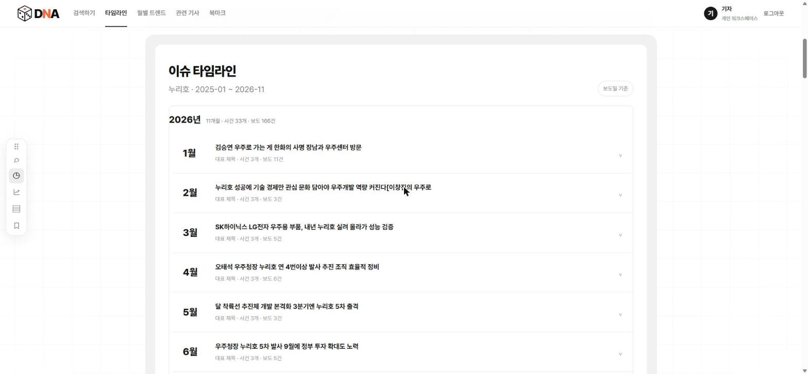
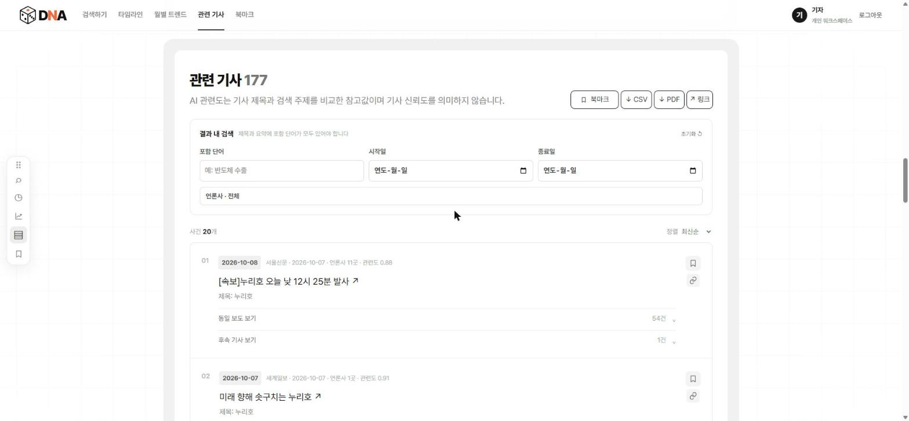

# 📌 DNA 뉴스 리서치 (팀 DICE)


## 📖 프로젝트 소개
이 프로젝트는 **동아일보 기자의 후속 취재를 위한 AI 뉴스 검색·이슈 타임라인** 서비스입니다.

과거 기사의 정확한 제목이나 날짜가 기억나지 않아도, 기억나는 키워드와 사건 설명만으로 관련 기사를 찾고 같은 사건 보도를 묶어 연·월별 흐름으로 보여 줍니다.

- 데이터: 빅카인즈에서 다운로드한 전국 일간지 12곳 기사(2025.1~2026.11) + 네이버 뉴스 매시간 수집분, 총 1,895,258건(2026.11.27 기준)
- 기사 본문은 수집·저장하지 않고 제목·키워드·언론사·날짜·원문 링크만 사용합니다.

> 이 폴더는 2026-11-27에 운영 중인 서버(배포 커밋 `c875898`)가 쓰는 파일을 모은 **복사본**입니다. 여기 파일을 고쳐도 서버에는 반영되지 않습니다.

## 🛠 기술 스택
- **Backend**: Python, FastAPI, Uvicorn, psycopg 3
- **Database**: PostgreSQL + pgvector (원격 DB)
- **AI/NLP**: multilingual-e5-base 제목 임베딩(768차원, sentence-transformers), Kiwi 형태소 분석
- **Frontend**: React 19, Vite 6, Tailwind CSS 4
- **Data Pipeline**: n8n(네이버 뉴스 검색 API, 매시간), Docker
- **배포**: cloudflared 임시 터널

## 🚀 실행 방법

### 1️⃣ 저장소 클론
```bash
git clone https://github.com/dudqls4796/dna-news-research.git
```

### 2️⃣ 프로젝트 폴더 이동
```bash
cd dna-news-research
```

### 3️⃣ 패키지 설치
```bash
# 백엔드 (Python 가상환경)
cd 1_검색서버_8010/백엔드
python -m venv .venv
.venv\Scripts\pip install -r requirements.txt

# 프론트엔드
cd ../../6_프론트엔드_소스
npm install
npm run build -- --configLoader runner   # dist 폴더 생성
```

### 4️⃣ DB 접속 정보 설정
`.env.example`을 `.env`로 복사한 뒤 DB 주소·계정을 채웁니다. **`.env`는 비밀값이라 저장소에 올리지 않습니다.**

### 5️⃣ 서버 실행
```powershell
# 검색 서버 (8010)
$env:SEARCH_PORT='8010'; $env:FRONTEND_DIST='<6_프론트엔드_소스\dist 경로>'; $env:REQUIRE_LOGIN='1'
.venv\Scripts\python.exe -X utf8 search\app.py

# 임베딩·사건 묶음 서버 (8011) — vbs는 같은 백엔드 폴더의 .venv를 쓰므로 3_임베딩서버_8011\백엔드에도 3️⃣처럼 .venv를 만든다
wscript 3_임베딩서버_8011\백엔드\db\start_embed_server.vbs

# 외부 공유 주소 (선택)
cloudflared tunnel --url http://127.0.0.1:8010
```
n8n에는 `4_n8n_네이버수집/naver_news_csv_workflow.json`을 가져오기(import)합니다.

### 6️⃣ 브라우저 접속
```
http://localhost:8010
```
회원가입 후 로그인해야 검색할 수 있습니다.

## 📂 프로젝트 구조
```bash
📦 dna-news-research
 ┣ 📂 1_검색서버_8010          # 공유 검색 서버 (FastAPI, 8010)
 ┃ ┗ 📂 백엔드
 ┃   ┣ 📂 search
 ┃   ┃ ┣ 📜 app.py             # API 라우트·로그인 게이트·화면 제공
 ┃   ┃ ┣ 📜 engine.py          # 검색·사건 묶음 조회·타임라인·월별 통계·캐시
 ┃   ┃ ┣ 📜 accounts.py        # 회원가입·로그인·북마크 API
 ┃   ┃ ┣ 📜 prompts.py         # 검색어 별칭·질문 해석 규칙
 ┃   ┃ ┣ 📜 cli.py             # 명령줄 검색
 ┃   ┃ ┗ 📜 test_*.py          # 테스트
 ┃   ┣ 📂 db                   # DB 접속·임베딩 공용 모듈
 ┃   ┣ 📜 requirements.txt
 ┃   ┗ 📜 .env.example
 ┣ 📂 2_화면_8010              # 8010이 내보내는 빌드 결과 (index.html + assets)
 ┣ 📂 3_임베딩서버_8011         # 임베딩·사건 묶음 트리거 서버 (8011)
 ┃ ┗ 📂 백엔드/db
 ┃   ┣ 📜 embed_server.py      # POST /embed → 임베딩 → 사건 묶음 → 검색 캐시 준비
 ┃   ┣ 📜 embed_articles.py    # 제목 임베딩 계산
 ┃   ┣ 📜 group_events.py      # 사건 묶음 (코사인 0.92 이상, 3일 이내)
 ┃   ┣ 📜 load_bigkinds.py     # 빅카인즈 파일 적재
 ┃   ┗ 📜 start_embed_server.vbs
 ┣ 📂 4_n8n_네이버수집           # n8n 워크플로·전처리 코드·DB 저장 SQL
 ┣ 📂 5_DB스키마               # schema.sql, migrations
 ┣ 📂 6_프론트엔드_소스          # React 원본
 ┃ ┣ 📂 src
 ┃ ┃ ┣ 📂 assets               # 로고·폰트
 ┃ ┃ ┣ 📜 App.jsx              # 화면 전체 (검색·타임라인·추이·관련 기사·북마크)
 ┃ ┃ ┣ 📜 search.js            # 검색 API 호출·결과 정리
 ┃ ┃ ┣ 📜 account.js           # 로그인·북마크 API 호출
 ┃ ┃ ┣ 📜 articlePrint.js      # PDF 저장
 ┃ ┃ ┗ 📜 main.jsx
 ┃ ┣ 📜 index.html
 ┃ ┣ 📜 vite.config.js
 ┃ ┗ 📜 package.json
 ┣ 📂 docs                     # 실행 화면 이미지
 ┗ 📜 README.md
```

### 데이터 흐름
1. n8n이 매시간 네이버 뉴스 검색 API로 기사를 모아 DB에 저장합니다(본문 미저장).
2. n8n이 8011 `/embed`를 부르면 제목 임베딩 → 사건 묶음 계산 → 8010 검색 캐시 준비가 이어서 실행됩니다.
3. 8010은 필수 키워드로 후보를 거른 뒤 임베딩 유사도로 관련 기사를 정렬하고, 사건 묶음으로 타임라인을 만들어 화면에 보여 줍니다.

## 📌 주요 라이브러리
- fastapi, uvicorn
- psycopg 3, pgvector
- sentence-transformers, torch (임베딩)
- kiwipiepy (형태소 분석)
- react, react-dom, vite, tailwindcss

## ✨ 주요 기능
- 회원가입·로그인 (로그인해야 이용 가능)
- 필수 키워드 + 자연어 주제 검색
- 같은 사건 보도 묶음 (동일 보도·후속 기사 보기)
- 연·월별 이슈 타임라인 (월별 주요 사건 최대 3개)
- 월별 기사 추이 그래프 (연도 선택)
- 관련 기사 최신순·관련도순 정렬, 결과 내 검색
- 북마크 (검색어별 폴더, 일괄 저장·해제)
- CSV·PDF(원문 링크 포함) 저장, 원문 링크 복사

## 📸 실행 화면
**이슈 타임라인** ('누리호' 검색)



**관련 기사** (최신순, 동일 보도 54건 묶음)



## 👩‍💻 개발자
| 이름 | 역할 |
|---|---|
| 이영빈 (팀장) | 총괄/PM, 백엔드 |
| 김요나 | 텍스트 처리, 주제 분석·분류 |
| 김현수 | 테스트 |
| 박준범 | 유사 기사 묶기 및 검증 |
| 임정현 | UI 및 UX |


